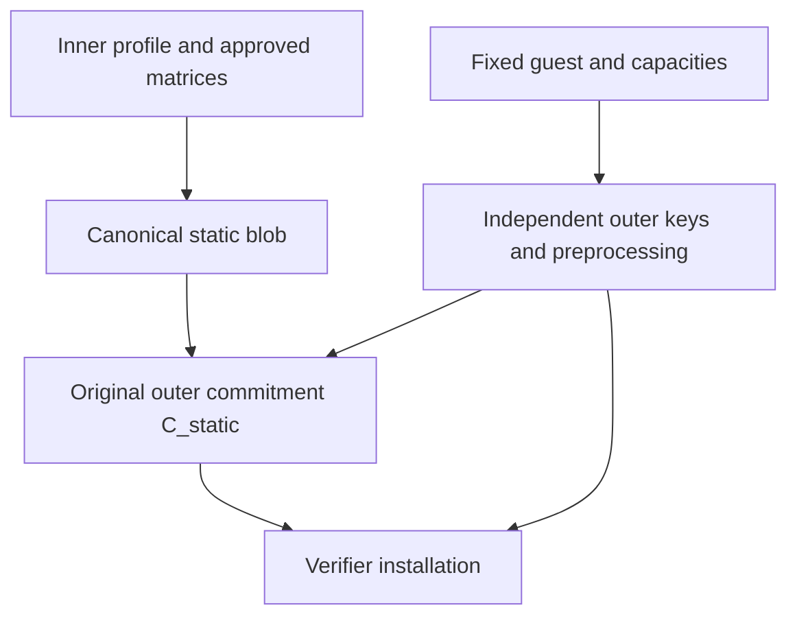

# Akita instance accumulation: ideal supplied-answer receipt design

## 1. Delivery target and historical branch scope

The user selected a **succinct standalone final receipt**, not external replay of the O(T) archive. Keep the reviewed native instance accumulator: cut Jolt before the full segment PCS call, complete one Akita reduction per update, and decide the final accumulated relation once. Do not restore completed per-segment proofs as accumulator inputs.

Use **one final ordinary Jolt/Akita proof** of a fixed guest that checks the update archive and its final decider. The archive is private advice to that proof, not public input, per-run embedded code or part of the transmitted receipt. This removes repeated full segment PCS proofs; it does not remove the one final proof or make its prover work constant.

**Scope:** this document specifies the ideal supplied-answer/quotient branch developed during proof-first research. The native finite archive core has independent admission; repaired input-local emulation, private continuation, native source-first extraction and weaker hidden-curve transport have conditional component approval. The latter has Q outside the square root. This branch does not instantiate a concrete ARO, complete guest/profile or measured receipt. Its earlier unrestricted emulator and old zero-finding proof remain withdrawn.

**Current experimental selection:** after the user authorized **Allow a heuristic prototype**, the separately reviewed [D1 model](AKITA_INSTANCE_ACCUMULATION_PROTOTYPE_MODEL.md) and [guest contract](AKITA_INSTANCE_ACCUMULATION_GUEST_SPEC.md) select direct concrete inner-transcript computation. D1 has no graph/AS/g/t/C_t, extra quotient opening, external Vhat checks or graph-imposed E4. It explicitly discloses restricted CH-I native-soundness content and a separate concrete outer-FS heuristic; no concrete theorem is claimed. All algorithms, costs and “selected” choices below concern the retained **ideal graph branch**, not mandatory D1 runtime machinery. [The D1 review](AKITA_INSTANCE_ACCUMULATION_PROTOTYPE_REVIEW.md) records its separate remaining gates.

The supported inner example remains T<=16, Nseg=4096, Pmain=56, a 65536-word RAM domain and a 2^22-cell receiver. This example's fixed parameters are not the outer guest's parameters. Other application/source geometries require their own admission; no unlimited-depth statement follows.

## 2. Objects and trust boundaries

| Object | Meaning and owner |
|---|---|
| Inner profile P | Exact original-source maps, continued-segment relation, independent 33-role setup, samplers, transcript, receiver and final schedule; approved before commitments |
| Static blob s_P | Actual approved inner matrices, canonical application preprocessing and validated proof-independent prepared data |
| Installed C_static | Original outer lattice commitment to exactly s_P under an independently provisioned outer advice map; supplied by the external verifier, not selected by the receipt author |
| Fixed guest G_skel | Bounded oracle-free archive/ledger/quotient checker, with approved code/ISA/codecs and canonical success output; fixed across runs |
| Outer installation I | Approved G_skel preprocessing, complete ordinary outer profile/key, capacities, expected C_static, and binding to P |
| Application statement X | The application's actual public input/output/panic policy and declared public run metadata |
| Outer statement x_o | X, installed profile selector, exact public acc, C_g/C_t handle identities and the bound quotient claim fields; no archive or boundary list |
| Archive a | Ordered segment frontend/update prefixes, boundaries and the final domain/suffix/terminal certificate |
| C_g source | Original pre-beta advice commitment to canonical X, a, all supplied component answers and graph witnesses determining g, with the admitted decoder |
| C_t source | Original full-grid K commitment to the quotient coefficient planes, outside guest byte advice |
| Receipt | x_o and one complete ordinary outer Jolt/Akita proof with its bounded metadata; the external Vhat checks remain part of acceptance |

An installation identifier selects already approved data. An arbitrary digest supplied with arbitrary preprocessing does not authenticate it. Public x_o has no intermediate-boundary or update-prefix list. Application I/O, acc and auxiliary claim bytes are real transport costs. Omitting advice bytes is not a zero-knowledge theorem.

The semantic target is the existing whole-run K-valued Jolt Boolean-table relation. Do not add Merkle RAM, host-advice authenticity, architectural-word endpoints, a new halt theorem or a different output-length convention.

## 3. Installation and setup

The selected setup route is [verifier-provisioned committed static data](AKITA_INSTANCE_ACCUMULATION_RECEIPT_SETUP.md). It avoids asking the guest to regenerate an ideal random setup stream by evaluating a concrete XOF.

1. Fix P, application preprocessing, inner matrix distribution and complete static-blob schema. Sample or approve the actual inner matrices before application commitments. With genuine independent 512-bit samples reduced modulo q, retain the existing modular-sampling bias bound. A CSPRNG has its own explicit premise.
2. Fix G and the archive/statement codecs. Select bounded public-input, untrusted-advice, trusted-advice, memory and instruction/trace capacities. Select one approved outer geometry or an explicitly authenticated finite family.
3. Provision the complete **ordinary** outer setup independently of the inner setup. Record its actual matrix sharing/sampling law, source maps, comparison radii and full suffix/terminal schedule. The existing shared-prefix backend is not the inner independent-role registry.
4. Freeze the outer trusted-advice map, then commit the exact static blob and its prescribed zero padding. Retain its canonical reference source/decommitment for the setup-binding proof and the prover's original object/hint for legitimate reuse.
5. Install the guest preprocessing, complete outer verification key and expected C_static. A final installation identifier may include this commitment; it must not feed back into the keys that created it or require the guest to contain its own verification key.

The dependency order is acyclic:

Only proof-independent prepared data may enter s_P. The guest still performs transcript-dependent evaluations, matrix contractions and acceptance checks. Neither header checks nor a matching seed label authenticates arbitrary prepared matrices.

The inner coefficient arrays alone contain 4,681,728 K elements: 74,907,648 bytes or 9,363,456 u64 words. The modern capacity-based advice interface requires at least a 2^24-word padded domain before additional blob regions. If materialized as 16-byte K elements, that padded word vector alone is 268,435,456 bytes. This is a representation count, not peak memory or a chosen outer profile.

Do not infer a new base-32 word encoding from `ceil(64/5)`. For zero-offset digits in [-16,15],
\[
 R_+(\delta)=15\frac{32^\delta-1}{31}.
\]
Here R_+(13)=17851687813267308015 is below 2^64-1=18446744073709551615; depth 14 suffices. Preserve the actual source encoding or prove an explicit affine alternative. A profile label such as “65-bit” is not a substitute for this check.

## 4. Prover and guest algorithms

### 4.1 Accumulation prover

For each legal nonempty segment, execute the [reviewed segment consumers](AKITA_INSTANCE_ACCUMULATION_SEGMENT_LOWERING.md), native source checks and one complete native accumulation fold. Retain the resulting prefix record and next private receiver witness. The fresh segment is never passed to a full `PCS::prove_batch`/suffix call.

After the final segment, produce the reviewed final domain/normalization prefix, three shrinking reductions and the complete genuine A-only terminal. Encode all records and that final certificate as the single logical archive a. Keep all admitted noncanonical source/decommitment paths; canonical byte serialization does not canonicalize mathematical gadget witnesses.

Reconstruct the complete fixed-input oracle ledger, including absorb/finalize/squeeze and rejected sampler attempts. Obtain its graph witnesses. The pre-beta C_g source binds **canonical X as well as the archive and all graph-defining data**; otherwise a changed public X could change g without changing C_g. Construct the quotient and C_t with the full-capacity semantics of the ordinary-MLE variant. Bind C_g/C_t/profile/nonce, obtain the raw output and accepted beta, then form acc and the small quotient claim. Keep every beta-dependent value outside C_g.

### 4.2 Fixed oracle-free guest

Conceptual entrypoint:

`verify_skeleton(x_o, UntrustedAdvice<ArchiveAndGraphBytes>, TrustedAdvice<StaticBytes>) -> u32`.

The wrappers identify actual SDK advice channels. `PrivateInput` has a separate ZK feature restriction and is not a substitute for `UntrustedAdvice` in the current Akita build.

The guest performs, in order:

1. Decode x_o and the installed static schema with canonical bounded encodings. Resolve only approved inner/outer profiles. C_static and the identity of the original C_g/C_t sources are enforced by the complete outer proof and external verifier, not by self-authentication of prover-chosen keys.
2. Decode the pre-beta envelope, require its X to equal public X, and decode one bounded logical archive plus the complete supplied-answer/graph-witness list. Require 1<=T<=16, exact admitted shapes/presence rules and nonwrapping counters; reject invalid sizes before allocating.
3. Initialize the registered zero receiver and bind the actual application/profile/setup context. Run every native transcript operation through the declared **supplied-answer machine**, reconstructing its exact input and Boolean graph point. Make no Theta_i or H_o call inside the guest.
4. For every ordered record, verify the complete segment frontend, derive its original-handle pending ledger, check exact predecessor/source/boundary links and replay the complete native update. Preserve physical source zeros, bounded domains, both extension planes, original F/H paths, required relation rows and final fold replay validation. Pending PCS claims are never treated as successful complete proofs.
5. Enforce initialization only on the first segment, the authenticated external successor on interior cuts and the original global final/public-I/O convention only on the last segment.
6. Verify the final domain/normalizer, every shrinking fold and the full terminal. Require the actual predecessor-authenticated terminal state and no remaining opening/setup obligation.
7. Require exact logical archive EOF and exact query/witness coverage. Check the CM tuple, all 1024 raw beta bits, the accepted sampler result and exceptional-point rule. Derive g(beta) and Z_D(beta), check gamma=1+Z_D(beta)*t_beta, and bind precisely the external acc and quotient claim. The C_t opening is proved outside the guest by the same outer batch. Return 1 only after every check. Ignored fixed-capacity cells are permitted only by the declared source/decoder relation; logical EOF does not prove their canonical zero value.

Every failure, including sampler exhaustion and unsupported capacity, returns non-success or panics. Neither result is accepted externally. The guest code, data-independent profile and verification key do not change with a.

### 4.3 One complete outer proof

Trace G_skel on x_o, the same original pre-beta advice source and installed static bytes. Use the admitted complete ordinary Akita stages and suffix, augmented by the original C_t source and its one ordinary full-grid opening. The claimed quotient value, source handles and guest acc must be linked in that single extracted relation. Do not use Dory aliases, a frontend-only verifier, a paused fold or a detached quotient proof.

Before publishing, run the complete external verifier below. Transmit x_o, pi_o and the bounded profile/geometry envelope, not a or dense quotient coefficients. The verifier already has its authorized installation and C_static.

## 5. External acceptance

Construct the expected outer public device from the approved layout, canonical x_o, **canonical postcard output 1u32 (byte 01)** and panic=false. Require public C_g to be exactly the proof's original untrusted-advice handle, and public C_t to be exactly its extra original quotient handle, with their frozen shapes. Derive the ordinary quotient query from public beta. Invoke the complete ordinary Akita verifier with installed preprocessing and C_static.

Also check the two exact external Vhat_i equations of public acc. Reject any handle/point/claim mismatch, unapproved profile, replacement key, wrong input/output/panic, malformed/trailing bytes, ordinary proof failure or external graph failure. A prover-supplied successful device or unrelated accumulator is not sufficient.

The current modern recursion example does not meet this interface: it uses Dory/BN254 SDK aliases, accepts public or per-run embedded archives, verifies completed independent proofs, and can log a verified return value 0. Its framing/host/runtime code is reusable only after the [source-backed changes](AKITA_INSTANCE_ACCUMULATION_RECEIPT_CODE_MAP.md). The lower-level modern Akita whole-program proving route and original advice commitment interfaces do exist.

## 6. Completeness

For every admitted valid inner source/path and legal segment witness, the inner construction produces accepting prefixes and a final decision apart from its declared sampler aborts. The true ledger supplies graph witnesses; the quotient identity and scaled-MLE identity give the honest source/claim; the installed static reference and exact original handle linkage are preserved. A correctly implemented G_skel returns 1, the complete outer argument accepts its enlarged batch, and both external graph equations hold. Add the CM nonce/prequery and exceptional-beta aborts to the native and outer completeness losses. This is conditional on the full all-valid-source/profile/guest certificates, not a proof of a program that has not been implemented.

This argument requires capacities for **all supported valid archives**, not only one benchmark. A finite profile compiler must derive archive length bounds from the full message grammar, outer geometry from the actual bounded guest, and every matrix/response/table/sampler condition from the complete schedule. Unsupported profiles are not silently accepted by dropping records or choosing weaker checks. Add outer sampler aborts to the inner completeness losses.

Private advice is compatible with this transport goal, but neither the inner nor the selected clear outer proof is asserted to be ZK.

## 7. Exact soundness claim and remaining model boundary

The selected research model is [the product experiment](AKITA_INSTANCE_ACCUMULATION_PRODUCT_EXTRACTION.md):
\[
 \Theta_i=(\mathrm{ro}_i,\mathrm{wo}_i,\widehat V_i)
 \leftarrow\mathrm{ARO}[F,m,\lambda_A,d,B_i],
 \qquad H_o\leftarrow\mathrm{RO}_o
\]
independently. For the repaired-emulator route, restrict the fixed efficient witness circuit to **input-local** \(B_i^{\mathrm{ro}_i}(x,\mu_x)=b_i(x,\mu_x,\mathrm{ro}_i(x))\); ro-free circuits are included. Access to arbitrary other \(\mathrm{ro}_i\) inputs is not admitted by this emulator. This is an explicit oracle-profile restriction, not a new knowledge assumption. The outer proof uses \(H_o\); its guest checks an **oracle-free** skeleton with supplied answers. The public statement binds the exact query accumulator, and the external verifier checks its two \(\widehat V_i\) equations. This is not the old fixed-hash guest with renamed oracles.

The reviewed actual-Theta product theorem preserves the saved original statement/accumulator while forking only \(H_o\). Its mixed-tree/PCS extraction claim is separate from an ordinary-SIS reduction. The latter requires the [paired input-local emulator](AKITA_INSTANCE_ACCUMULATION_ARO_WITNESS_SCOPE.md), with **one persistent augmented state across the whole bounded collision producer**, and its corrected query/CPU ledger; the original unrestricted-B citation does not supply it. Full frontend/guest projection remains a separate premise. Independence of \(H_o\) avoids the same-oracle Lemma 9.1 restriction, without invalidating that restriction in its own model.

The reviewed [private-continuation transformer](AKITA_INSTANCE_ACCUMULATION_PRIVATE_ARO_CONTINUATION.md) retains the original actual receipt and both actual external decisions, then performs extraction against private simulated continuations. It yields a legal actual-Theta producer \(E_{\rm private}\), without asserting consistency with arbitrary future actual-oracle observations. Under complete projection, source/profile and native-soundness contracts, the conditional ledger is
\[
 \Pr[\mathrm{false\ receipt}]
 \le \beta_{o,\mathrm{private}}+
      \varepsilon_{\mathrm{static}}+
      \varepsilon_{\mathrm{ZF}}(E_{\mathrm{private}})+
      \varepsilon_{i,\mathrm{ARO}}(E_{\mathrm{private}}).
\]
Here \(\beta_{o,\mathrm{private}}\) includes the actual-Theta extraction/cutoff loss, both complete-run coupling losses, outer collision advantages at full emulation time, and declared setup/sampling losses. The reviewed transport theorem supplies \(\varepsilon_{\rm ZF}\), with **Q outside the square root** and all its terminal/hidden queries priced. Actual external queries and virtual extraction work have separate budgets; virtual work is not free. Count each setup/static/cutoff event once. The native term first uses the **input-local paired** ARO-to-ro lift, then the [fixed-input compiler](AKITA_INSTANCE_ACCUMULATION_CHAINED_TRANSCRIPT.md). This is not yet a numerical or end-to-end admission.

The [quotient construction](AKITA_INSTANCE_ACCUMULATION_ORACLE_QUOTIENT.md) replaces a dense guest polynomial by an original lattice-held quotient \(t\), using
\[
 \widehat V_i(g(X))=1+Z_D(X)t(X).
\]
Weak-source relation binding uses neither canonical extraction nor commitment homomorphism. Adaptive authentication uses the separate reviewed hidden-curve theorem, not postchallenge Schwartz–Zippel. The reviewed [ordinary-MLE variant](AKITA_INSTANCE_ACCUMULATION_QUOTIENT_MLE.md) uses **outer** \(E_o=F=K^4\) and one full-grid ordinary opening; **inner** \(E_i=K^2\) is unchanged. Its degree includes the whole quotient capacity and its sampler rejects at most 31 exceptional points. All 1024 raw output bits remain in the first graph equation.

The [deterministic projection theorem](AKITA_INSTANCE_ACCUMULATION_OUTER_PROJECTION.md) separates PCS weak sources, K-valued machine tables, canonical consumed bytes and the actual guest checker. Its full-grid, source-comparison, instruction/read and guest certificates are not supplied by an honest packing function or by the PCS theorem's name. The new guest is not implemented.

**Ordinary outer language soundness is insufficient:** it proves existence, not efficient production, of an accepting computational inner transcript. The earlier [fixed-hash composition theorem](AKITA_INSTANCE_ACCUMULATION_RECEIPT_SOUNDNESS.md) remains conditional on unapproved CH-I/CH-O assumptions. A fixed Blake/SHAKE computation is not programmable ideal-oracle evaluation. Neither those assumptions nor a concrete ARO realization are silently accepted by choosing this ideal-model route.

### 7.1 Resource results and remaining extraction obligation

The [reviewed dense-flat cost result](AKITA_INSTANCE_ACCUMULATION_ORACLE_QUERY_COST.md) rules out that specific dense polynomial in the current byte-advice layout. Fixed-input chaining reduces arity but its stated dense T16 illustration still exceeds the 512 MiB untrusted-advice cap before absorb costs. Holding the quotient in an original PCS source removes that particular guest-storage requirement, not its host polynomial work or source capacity.

The [full-frontend-tree example](AKITA_INSTANCE_ACCUMULATION_EXTRACTION_BUDGET.md) forces at least \(2^{280}\) distinct forwarded inner queries for the specified flat-input enumeration. It refutes copying Q32 onto that route, not all extractors or honest performance. Reviewed [frontend source-first extraction](AKITA_INSTANCE_ACCUMULATION_SOURCE_FIRST_EXTRACTION.md), [native source-first extraction](AKITA_INSTANCE_ACCUMULATION_NATIVE_SOURCE_FIRST.md) and [private continuation](AKITA_INSTANCE_ACCUMULATION_PRIVATE_ARO_CONTINUATION.md) now provide conditional alternatives. Native source-first retains unadmitted nodes' original tree factors; private continuation removes virtual heads from actual native-key counts, not emulator CPU or coupling errors. The [original PCS-tree ledger](AKITA_INSTANCE_ACCUMULATION_PCS_EXTRACTION_COST.md) remains valid for that configured tree. A complete selected schedule and nonvacuous composed policy are still required.

The [composed-policy note](AKITA_INSTANCE_ACCUMULATION_COMPOSED_POLICY.md) now gives the complete symbolic loss ledger, strict cutoff/runtime obligations and illustrative sufficient inequalities. Its authentication binding target scales as \(\varepsilon_{\rm auth}^2/Q^2\); a standalone binding estimate does not establish that composed advantage. The optional \(2^{-128}\) calculation is **not an added user acceptance requirement**. No numerical guest/profile or hardness budget has been instantiated.

[The oracle-limits note](AKITA_INSTANCE_ACCUMULATION_ORACLE_LIMITS.md) retains its actual evidence scope. A generic ordinary-ROM class separation is not impossibility of this fixed bounded receipt. Conversely, ideal ARO existence and reviewed conditional lemmas do not instantiate the missing concrete verifier, security profile or performance result.

### 7.2 Further interface results, not silent profile changes

The independently reviewed [compact-CM compiler](AKITA_INSTANCE_ACCUMULATION_COMPACT_CM.md) can replace literal CM inputs with a framed transcript root, **provided the external verifier recomputes that root** and the new two-branch root error and all absorb work are charged. It reduces component arity, not original handle transport. The literal-CM grammar above remains unchanged until an explicit profile selects this extension; a short digest alone is not its theorem.

The reviewed [concrete graph study](AKITA_INSTANCE_ACCUMULATION_CONCRETE_GRAPH.md) constructs a degree-two graph for the existing optional Keccak overwrite duplex and prices its witness and quotient costs. It is not SHAKE and does not change the default Blake2b backend. Its factored polynomial is **efficiently distinguishable** from a uniform ideal extension. Correct Boolean semantics do not instantiate the receipt theorem. The user now permits an explicitly named protocol-specific heuristic **prototype**, not a proved concrete-security bridge. This distinction is not a receipt forgery or proof that lattice accumulation is impossible.

The [consumed-byte certificate](AKITA_INSTANCE_ACCUMULATION_CONSUMED_BYTES.md) identifies the existing LD-to-PEXT full-operand constraint that makes completed subword reads canonical. Raw LD/SD, source-version preservation and the complete fixed guest still need their stated certificates. No new range constraint or honest-source restriction is introduced.

## 8. Cost contract and recursive control

Let \(F_i\) be segment frontend proving, \(U_i\) the complete native update, \(D\) the single native decision, \(P_{\rm query}\) the complete host query/curve/quotient work, and \(G_{\rm skel}\) the fixed oracle-free guest. The selected route must account for
\[
 P_{\rm acc}=\sum_i(F_i+U_i)+D+P_{\rm query}
 +\operatorname{Trace}(G_{\rm skel})
 +P_o(\operatorname{Trace}(G_{\rm skel}),C_g,C_t).
\]
Include original C_g/C_t creation, polynomial/interpolation storage and all source-opening work once, wherever assigned in this ledger, plus cold/warm setup and encoding. For the public query accumulator and its bound auxiliary fields,
\[
 B_{\rm receipt}=|\operatorname{Enc}(x,\mathrm{acc},\mathrm{aux})|+B_o,\qquad
 V_{\rm receipt}=V_o+2\,\operatorname{Cost}(\widehat V_i)
                 +\operatorname{Cost}(\mathrm{public\ decoding}).
\]
An ideal extended-oracle call has no established software cost here. The receipt does not transmit the archive, but its query accumulator is a real public-size term; packing its Boolean first point does not compress its arbitrary field-valued second point for free.

The control uses the **same** continued-segment frontend, endpoint sources, security policy, private archive delivery and static preprocessing opportunities. It fully discharges each segment's ordinary PCS ledger and suffix; one fixed guest checks those completed segment proofs and the same links/global endpoints. For an ARO comparison, the control must also authenticate its complete oracle ledger under the same declared model and charge its query-production/outer-proof costs. Do not compare this construction with an unpriced ideal oracle against a concrete-hash control, add accumulation-only raw-source bounds to that control, or compare against independent-job conjunction.

Measure installation, proof generation, peak memory, retained state, final proof/input bytes and external verification separately. Include trusted-advice source expansion/opening and all outer proving costs. No speedup follows merely from removing segment suffixes. The requested performance gate remains unmeasured, and cutover is not approved on an operation model alone.

## 9. Admission record

Reviewed components include the finite inner construction/source cuts, ordinary Akita/advice interfaces, conditional composition/static reference, actual-Theta product/source-first extraction, fixed-input simulation, quotient/MLE algebra, parametric projection, paired emulation, private continuation, native source-first extraction and weaker hidden-curve authentication. The old unrestricted emulator and old zero-finding bound are superseded, not restored. [The review record](AKITA_INSTANCE_ACCUMULATION_RECEIPT_REVIEW.md) gives the precise scope. No review admits the complete selected receipt.

Still required before receipt implementation admission:

1. Instantiate the reviewed paired input-local emulator and weaker hidden-curve theorem on the selected oracle/CM/source representation, sampler and strict budgets. Fixed-state uniformity alone is not a transport proof; the reviewed replacement pays explicit hidden observations and coupling errors.
2. A complete selected outer frontend/source/read/guest certificate, with exact native emission/sampler correspondence and original statement/static-reference preservation.
3. Bounded archive/query/quotient geometry, actual outer field/schedule/source maps and every matrix/shared-view/reference comparison. The inner 33-role table is not the outer inventory.
4. A justified full composed runtime/query policy, including cutoff tails, mapped native keys, persistent-emulator CPU and runtime-sensitive SIS advantages. Do not claim overall 128-bit security from per-matrix estimates.
5. An exact declared oracle interface and experimental assumption boundary. The user permits a protocol-specific concrete-ARO heuristic prototype, not a concrete security theorem or blanket CH-I/CH-O approval. State every restricted implication and distinguish experimental authorization from cryptographic admission.
6. Final independent end-to-end admission, then implementation, complete producer/verifier execution, adversarial behavioral checks and paired measurements. Conditional review alone does not close these gates.

The local implementation branches already created remain free of implementation changes while these receipt gates are unresolved. They do not certify a receipt or authorize an unreviewed security substitution.

## References

- [Native instance design](AKITA_INSTANCE_ACCUMULATION_DESIGN.md), [review](AKITA_INSTANCE_ACCUMULATION_REVIEW.md), [exact segment lowering](AKITA_INSTANCE_ACCUMULATION_SEGMENT_LOWERING.md).
- [Receipt soundness and oracle boundary](AKITA_INSTANCE_ACCUMULATION_RECEIPT_SOUNDNESS.md), [setup/admission](AKITA_INSTANCE_ACCUMULATION_RECEIPT_SETUP.md), [modern code map](AKITA_INSTANCE_ACCUMULATION_RECEIPT_CODE_MAP.md).
- [Independent receipt review](AKITA_INSTANCE_ACCUMULATION_RECEIPT_REVIEW.md), [ARO candidate and full primary source](AKITA_INSTANCE_ACCUMULATION_ARITHMETIZED_ORACLE.md), [oracle-limit evidence](AKITA_INSTANCE_ACCUMULATION_ORACLE_LIMITS.md).
- [Akita](SOURCE_PROVENANCE.md#akita), Definition 3.15, Lemma 10.2, Theorems 10.31/10.33 and their stated models; [Nova](SOURCE_PROVENANCE.md#nova), §1.1 and footnote 1, retrieved through qmd.
- [BCMS20 published chapter](https://link.springer.com/content/pdf/10.1007/978-3-030-64378-2_1.pdf), Theorem 1 and model caveat; [BCLMS21 published chapter](https://link.springer.com/content/pdf/10.1007/978-3-030-84242-0_24.pdf), Theorem 1, Remark 1 and §2.2.

Verification so far is source/paper inspection and exact arithmetic for setup counts and gadget reach. It is not a native receipt proof execution.
